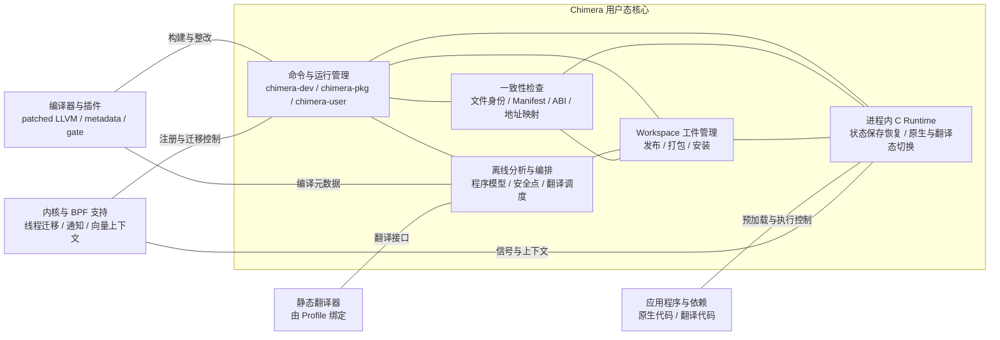
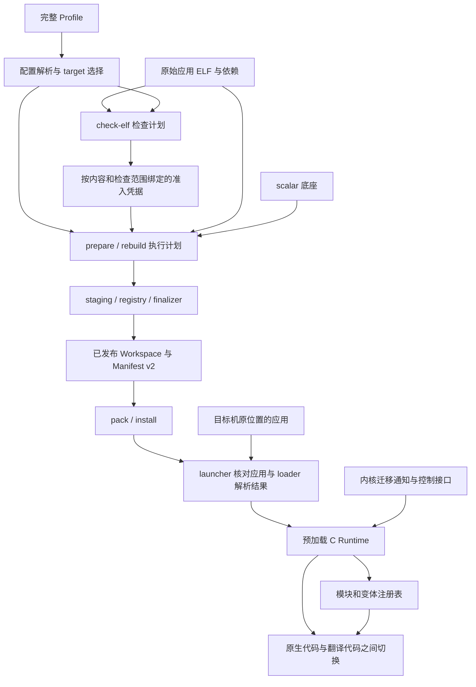

# Chimera 架构

Chimera 把应用的离线分析、翻译工件生产与进程内迁移执行分开。离线端根据显式 Profile 选择模块、分析安全点、生产翻译代码和地址映射，发布带 Manifest v2 的 Workspace；在线端核对实际应用文件，使用包内 scalar loader 启动应用，再由 C Runtime 加载工件并处理迁移信号。

当前实际组合是 Linux / RISC-V64 / RVV，运行场景为 `linux_riscv64_rvv_v1`。框架中的 target、scene 和 capability 注册接口用于隔离职责；已注册的其他平台、架构或场景不能从这些接口的存在推导出来。

## 阅读路径

| 主题 | 内容 |
| --- | --- |
| [离线流水线](offline.md) | 检查准入、step 契约、集合结果、增量重建与发布事务 |
| [Workspace 与交付](workspace.md) | Manifest v2、模块选择、内容锚定、打包和安装 |
| [在线运行时](runtime.md) | launcher、C Runtime 初始化、工件装载、迁移状态与失败语义 |
| [扩展机制](extensibility.md) | step、target、scene、capability 的真实注册位置与报告 step 示例 |
| [目标与场景](targets/README.md) | 通用机制与目标适配的边界 |
| [RVV 目标](targets/rvv/README.md) | 双向 VLEN 路由、共享状态、内核信号、trap 与地址映射 |
| [安全点分析](safepoints/README.md) | 安全性条件与分析结果的组合 |
| [栈对象活跃性](safepoints/stack-liveness.md) | 栈布局与跨调用传播 |
| [标量宽度状态](safepoints/scalar-width.md) | 硬件宽度缓存及跨域值的活跃性 |
| [调用边界](safepoints/call-boundaries.md) | 内部调用、开放边界与外部标量叶函数契约 |
| [ABI](../abi/README.md) | Manifest、工件、翻译状态与内核接口的精确定义 |

命令与配置分别见[开发者 CLI](../cli.md)、[应用集成者指南](../../integration/README.md)和[应用使用者指南](../../user/README.md)。

## 整体架构

Chimera 的用户态核心连接离线工具、工件交付与在线执行。编译器和静态翻译器通过工具接口接入，内核提供线程迁移、通知及向量上下文支持。图中连线表示组件之间的协作关系，执行顺序见下一节的数据流图。

“一致性检查”汇总已有的准入身份、文件内容、Manifest、ABI、翻译 provenance 和地址映射契约校验，具体判据由对应模块实现。C Runtime 实际预加载到应用进程内；“用户态核心”是逻辑职责边界，不是一个独立进程。Workspace 将离线生成的工件交给在线组件，Runtime 据此保存状态并切换执行代码体。

## 离线生产与在线消费的数据流

`check-elf` 解释当前 workflow 声明的二进制检查，生成诊断、编译整改建议和准入凭据；它不创建 Workspace，也不执行生产 step。`prepare` 消费通过准入的输入和 Profile，生产可交付工件。在线阶段消费这些工件，按精确地址查表和解释场景状态，不重新执行离线安全性算法。

## 源码职责映射

以下路径均相对于仓库根目录。

| 组件 | 源码位置 | 职责 |
| --- | --- | --- |
| 角色 CLI | `cli/chimera/{dev,pkg,user,cli}.py` | `chimera-dev`、`chimera-pkg`、`chimera-user` 的命令组织与调度 |
| 配置 | `preprocessing/offline/config/` | TOML、端点、工具与目标文件配置的解析和校验 |
| workflow | `preprocessing/offline/analysis_profile/` | step/target 注册、声明解析、检查计划、执行与 replay |
| 通用契约 | `preprocessing/offline/analysis/core/contracts/` | `AnalysisContext`、`AnalysisStep`、服务与可选能力协议 |
| 发布事务 | `preprocessing/offline/analysis/core/workspace/` | 身份、内容锚定、staging、registry、发布和回滚 |
| 离线生产者 | `preprocessing/offline/analysis/` 的各 step 目录 | 模块选择、反汇编、程序模型、安全分析、翻译、映射、补丁与最终发布 |
| 翻译器 | `preprocessing\translator\rvv_sbt_tool`（源码与 `README.md`） | Chimera 源码位于此目录；Profile 的 `translator_path` 指向所选入口脚本 |
| 交付包 | `cli/chimera/{workspace,workspack}.py` | `.workspace` 归档、安装与安装完整性校验 |
| Manifest 与验证 | `runtime/artifacts/` | Python 编解码、scene/capability 验证、C 装载器与内容校验 |
| 启动器 | `runtime/launcher/` | 实际模块解析、loader 调用、预加载环境及迁移控制适配 |
| C Runtime | `runtime/runtime/` | 初始化、模块注册、TLS 状态、信号与迁移决策 |
| 操作系统接口 | `runtime/interfaces/uapi/linux/` | 动态装载、上下文访问、环境处理和信号安装 |
| 内核注册 | `runtime/bpf/loader/`、`runtime/interfaces/uapi/chimera_uprobe.h` | 可迁移 ELF inode 的 BPF 队列登记与布局契约 |

## 三条边界

**应用文件与交付工件分开。** 主程序和应用自己的依赖以 `delivery=target` 留在目标机；选中的 scalar 底座以 `delivery=package` 随包。输入 ELF 不被改写，原始 `PT_INTERP` 只用来选择包内 loader 的 basename。

**分析结论与执行机制分开。** 安全分析决定何处可以退出翻译态；offset-map 决定具体 PC 能否在两个代码体之间精确转换；信号处理器只执行这些已发布的决定。安全点不等于任意指令都存在映射。

**通用结构与目标政策分开。** registry 理解 module、variant、artifact 和不透明的 route/body；RVV scene 定义 VLEN 路由、body 标签、TLS 符号、信号负载和 trap 编码。ABI 的变更需要同时审视生产者、Python 验证器、C 装载器和翻译器。
