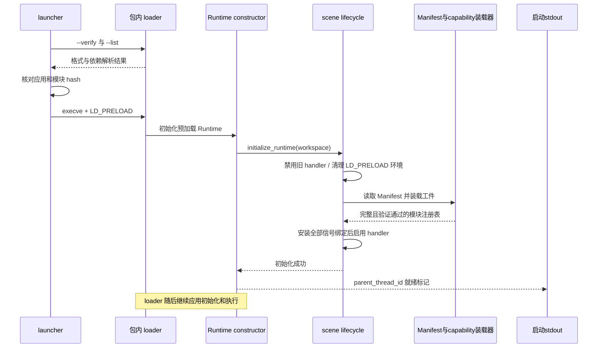
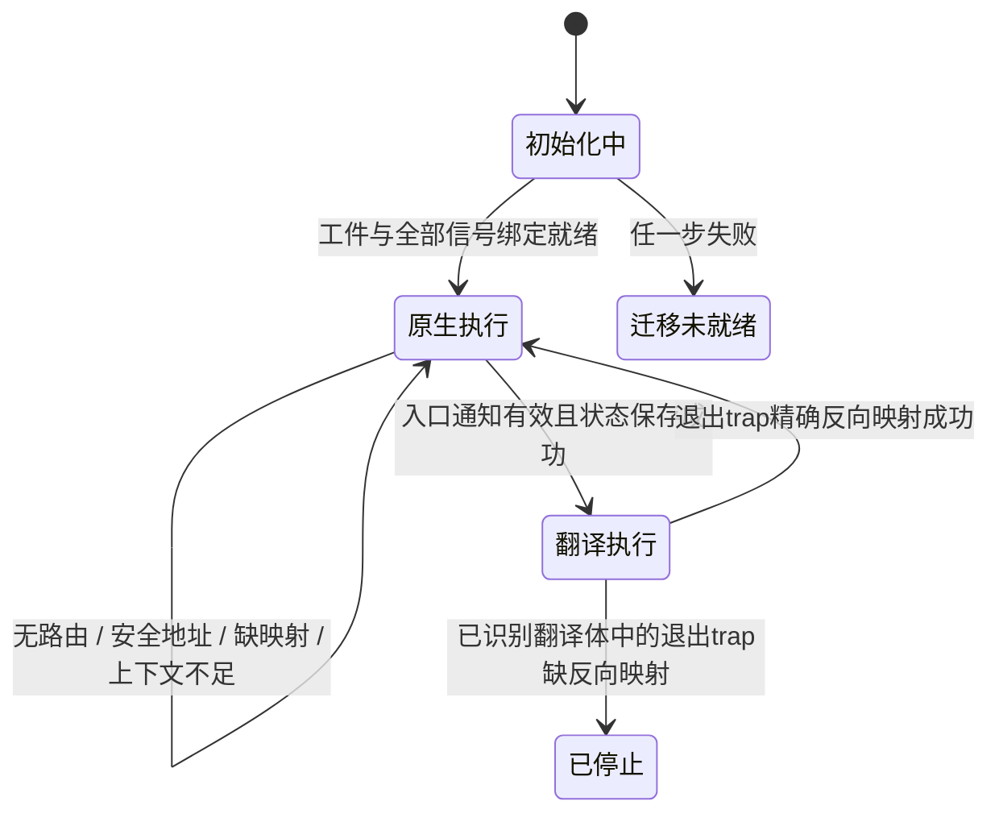

# 在线启动、工件加载与迁移

在线链路由 Python launcher 和进程内 C Runtime 组成。launcher 核对 Workspace、目标机应用和实际 loader 解析结果，随后用 `execve()` 替换自身；C Runtime 通过预加载构造函数初始化模块注册表和信号处理器。迁移决策使用离线工件，不在信号处理期间重新运行安全分析。

## launcher 的启动契约

`runtime/launcher/run/chimera/launcher/run.py` 的 `prepare_launch()` 产生 `LaunchRequest`，其中包含 loader、原位置的应用、参数、显式搜索路径、模块解析结果和环境。

1. 验证 Workspace 的 Manifest、工件、scene 和环境；读取主模块，要求应用 basename 和整文件 SHA-256 匹配。
2. 从应用 `PT_INTERP` 取得 loader basename，在 Manifest 中找到同名 `delivery=package` 模块，使用 `scalar/` 下的实际文件。缺少动态解释器或包内 loader 时拒绝启动。
3. 构造搜索路径，依次包括 `scalar/`、`artifacts/`、`artifacts/runtime/`、应用目录及目标机 `ld.so.conf` 声明的库目录。
4. 分别调用包内 loader 的 `--verify` 与 `--list`。两者是独立模式，不能合并成一次调用。
5. 对 loader 报告的已记录模块和主程序计算整文件 SHA-256，与 Manifest 比较；内容不同即拒绝启动。路径搜索优先级本身不能代替 hash 核对，例如应用的 `DT_RPATH` 可以影响实际选择。
6. 通过 scene 的 launch adapter 设置 `CHIMERA_WORKSPACE`、预加载 Runtime 与启动 PID 标记，生成最终 loader 命令。

最终启动形式在实现中为：

```text
<package-loader> --library-path <paths> <original-application> <application-args>
```

launcher 不写回应用 ELF。环境适配器移除继承的 `LD_LIBRARY_PATH`，把 Runtime 加入 `LD_PRELOAD`，并在存在资源目录时设置 `CHIMERA_RESOURCES`。外部标量叶函数契约启用时，还会拒绝影响证明的插桩环境、检查已解析 provider 和绑定信息，并在相应条件满足时使用 `LD_BIND_NOW=1`；细节见[调用边界](safepoints/call-boundaries.md)。

`--list` 只列依赖，主程序由调用者显式加入。常规路径对 loader 报告中的已记录文件逐个核对；不能把该预检查夸大为对后续任意 `dlopen()`、运行期间文件替换或所有未记录模块的持续监控。模块集合和文件在验证后仍需保持稳定。

## C Runtime 初始化



构造函数位于 `runtime/runtime/inject/inject.c`。scene lifecycle 先令信号包装器失活，再处理环境、加载 Workspace，最后安装信号；只有所有步骤成功才返回成功并输出 `parent_thread_id=<pid>`。Runtime 仅在 `CHIMERA_LAUNCH_PID` 与当前进程 PID 相同时输出通知，因此 fork 子进程不会重复输出。

C 装载器重新读取 Manifest，选择 target/scene handler，核对所有声明工件的 SHA-256、capability 契约和 Runtime ABI。它定位已装载原始模块的地址范围，加载每个 module 的可选 safety 工件和每个 variant 的翻译代码、offset-map；翻译代码还需提供与变体属性指纹匹配的 provenance 符号。装载器把实际原始模块基址写入翻译 DSO 的 `<variant_id>_original_base_addr` 槽。

工件通过 `dlopen(..., RTLD_NOW | RTLD_GLOBAL)` 加载，导出表通过 `dlsym()` 获取。最终注册表验证包括原始/翻译代码体范围不相交、路由唯一、映射条目有序且在代码范围内，以及正反映射一致。只有有效注册表才用于迁移。

初始化失败会写诊断并保持迁移 handler 禁用；当前 constructor **不会因初始化失败主动终止应用**，也不会输出成功就绪标记。信号安装失败会尝试还原已安装的 disposition；即使还原失败，scene 包装器也保持失活。应用进程仍存在、环境中已有 `CHIMERA_WORKSPACE` 或 loader 已执行，都不能证明迁移可用。

## capability 的必需性

通用 Manifest 负责记录工件，scene 决定哪些表示可以被消费。当前 Runtime 必须有一个 workspace Runtime ELF，每个模块至少有一个翻译变体，每个变体必须有一个翻译代码 ELF 和一个 offset-map ELF；模块 safety ELF 可选。没有 safety 条目的地址按未知/不安全处理，不会被默认认定为安全点。

Python 验证器遇到未知且 `required_by` 含 `runtime` 的 capability 时失败；未知的可选工件可以略过其语义处理，但仍受路径和摘要校验约束。C capability registry 按 owner、capability、representation、ABI 与数量约束分派；已知 capability 的错误 owner 或 ABI 也会失败，不能靠删除 `required_by` 绕过。

## 执行状态与切换



“原生执行”指当前选中模块的原始代码体，包含随包 scalar 模块；“翻译执行”指某条已发布路由对应的翻译 DSO。状态属于线程的执行位置和方向状态，不是整个进程只有一个全局翻译开关。Runtime 为两条 RVV 方向各提供线程局部状态数组。

入口通知首先定位原始模块、判断该地址是否已安全，再按通知中的源端点寻找路由。找不到匹配模块、源端点、变体、精确正向映射，或无法读取/保存向量上下文时，不改写 PC。有效入口先保存源状态，再将信号上下文 PC 改为翻译地址。

翻译代码在已打补丁的安全点触发退出信号。Runtime 用当前翻译 PC 的精确反向映射恢复原始 PC；它不取邻近映射、不简单跳过 trap。已识别翻译体中缺少反向条目时记录诊断并终止进程，避免无限重陷阱或在 helper 的临时栈帧内错误继续。RVV 的具体信号、编码和返回值见 [RVV 目标](targets/rvv/README.md)。

## 内核注册与控制证据

`register` 把实际模块文件 inode 以零偏移公告提交到 BPF 队列；安全点已在 prepare 中转成翻译 DSO 的 trap，不逐点注册 uprobe。目标机模块必须由 loader 解析得到实际路径；注册状态不在 Workspace 中持久化，重启内核后需要重新登记。

迁移命令在第一次控制写入前核对所选线程属于同一线程组，读取每个线程 `/proc/<tid>/status` 的 `SigCgt`、`SigIgn`、`SigBlk`，要求 scene 的入口和退出 handler 已捕获且未屏蔽，然后写入场景编码的请求。这是启动就绪预检查，不是迁移完成 ACK；写入控制文件成功或 CLI 的线程列表输出，只能证明请求已提交。内核到用户态的通知及真实执行位置仍需独立观察。

源码入口：`runtime/launcher/run/chimera/launcher/`、`runtime/launcher/preload/`、`runtime/runtime/{inject,migration,mapping,state}/`、`runtime/artifacts/manifest/linux_riscv64_rvv_v1/`、`runtime/bpf/loader/`。接口版本与精确布局见 [ABI](../abi/README.md)。
