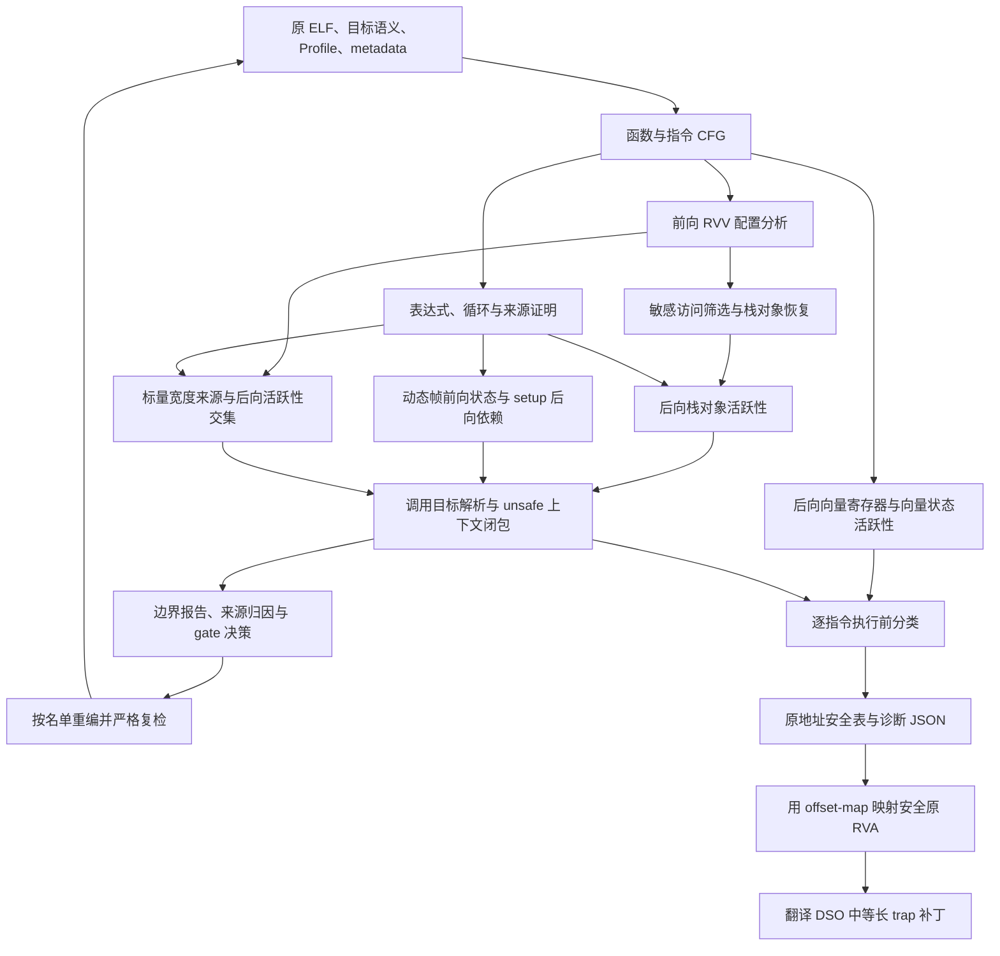

# 安全点分析

Chimera 把安全点定义在**原程序一条指令执行之前**：在当前分析范围内，没有必须随原硬件宽度保留的向量寄存器／向量状态、向量栈对象、动态 VLEN 栈帧准备值、动态帧或本地标量宽度缓存。安全点允许运行时选择相应迁移续点；它不单独证明任意向量算法的数值等价，也不代替真实迁移验证。

## 从输入到补丁

输入包括原 ELF 及反汇编建立的 `Program`、函数与指令 CFG、目标架构语义、`min_vlen_bits`、编译器 metadata 和安全步骤参数。外部标量叶证明还需要本次实际选择的 scalar 库及内容身份。分析器先产生每条原指令的 `live_before`，随后合并为 `SafetyRecord`。



各分析使用不同状态域，不把“某个值出现过 VLEN”直接等同于“当前仍不安全”：

| 分析 | 状态与方向 | 输出用途 |
|---|---|---|
| RVV 配置 | 沿 CFG 前向传播可能的 SEW、LMUL、AVL 配置，汇合可能状态至固定点 | 判断访问是否依赖 VLEN，解释向量操作 |
| 向量寄存器 | 对 use/def 后向求固定点；含虚拟寄存器 `32` 表示 `vl`／`vtype` 状态 | 避免在 `vset*` 与依赖它的向量指令之间误判安全 |
| 栈对象 | 对完整 metadata 身份或二进制恢复身份后向求活跃性 | 保留尚会读取的向量栈数据 |
| 栈帧 | 前向传播 SP 的动态状态；从敏感调整后向追踪准备值 | 保留分配之前的 setup 及恢复之前的帧 |
| 标量宽度 | 前向追踪真实内容，后向追踪实际读取，取二者交集 | 保留仍需使用的本地宽度副本 |
| 调用继承 | 从活跃调用站点沿内部调用图单调扩展至固定点 | 防止被调函数或其后代在祖先敏感状态尚存时迁移 |

后向活跃性的基本式为 `OUT[n] = ⋃ IN[s]`（`s` 是后继），`IN[n] = USE[n] ∪ (OUT[n] − DEF[n])`。具体 use/def、保守标记和 ABI 边界由各专题说明。普通调用结束 ABI 规定的 volatile 向量状态生命周期，但栈对象、callee-saved 缓存和继承上下文有独立生命周期。

## 分类与报告的含义

分类器把向量原因与栈分析原因相并；原因非空即 `safe=false`。栈分析保留以下独立原因：

| 原因 | 当前点仍需保留的内容 |
|---|---|
| `live_stack_vector_data` | 向量栈对象、保守对象或继承的敏感上下文 |
| `live_vlen_stack_setup` | 将流入动态 SP 调整的准备值 |
| `live_vlen_stack_frame` | SP 尚未恢复的动态 VLEN 帧 |
| `live_vlen_scalar_data` | 实际仍活跃的本地硬件宽度缓存，或其未闭合效果缺口 |

一条 unsafe 指令不必产生 finding。finding 表示活跃上下文遇到未覆盖调用边界，需要补齐目标证据、消除源头或完成受支持的外部证明。warning 可以解释精度损失、范围假设和选择影响；它不自动成为 gate 候选。

例如下面的 `mv sp,s0` 按执行前状态分类，不能把恢复后的事实提前用于本指令：

```asm
mv   s0,sp
csrr t0,vlenb
sub  sp,sp,t0       # 此处开始调整，准备值尚活跃
jal  ra,worker     # 动态帧仍活跃，并传播到 worker
mv   sp,s0         # 执行前动态帧仍活跃
nop                # 若无其他原因，此处才可重新安全
```

报告同时保存 `unknown_stack_size_policy`、`assumption`、`conditional` 和 `scope_exclusions`。选择条件范围后，即使 finding 为零、排除项为空，结论仍然有条件。检查缓存、凭证和 prepare 必须使用同一策略与当前检查规则。

## 原地址事实与翻译地址补丁

安全分析不改写输入 ELF。JSON 以原地址记录 `safe`、`unsafe_reasons`、活跃对象和 `original_rva`；安全 ELF 表继续使用原地址／布尔值契约。翻译步骤另行生成代码和 `offset-map`。

`patch-safepoints` 从安全原 RVA 中选取有映射的项，映射到对应翻译序列的第一条指令，再由目标的 trap 服务生成等长编码。补丁作用于翻译 DSO。每轮从校验过内容摘要的未打补丁副本重建，所以安全集合缩小时，上一轮不再允许的 trap 会恢复成原翻译字节。地址映射正确与安全事实正确是两项分别需要验证的条件。

## 阅读与源码入口

1. [栈对象、动态帧与未知尺寸范围](stack-liveness.md)：先理解内存对象、SP 和 setup 为什么分开。
2. [标量宽度缓存](scalar-width.md)：理解宽度来源、活跃性、调用 ABI 和出口规则。
3. [调用边界、来源归因与 gate](call-boundaries.md)：把局部状态接到全程序闭包和应用重编流程。

实现入口是 [SafetyStep](../../../../preprocessing/offline/analysis/safety/step.py)、[StackLivenessAnalyzer](../../../../preprocessing/offline/analysis/safety/stack_liveness/analyzer.py) 和[分类器](../../../../preprocessing/offline/analysis/safety/classifier.py)。RVV 的[配置分析](../../../../preprocessing/offline/analysis/arch/riscv/rvv/config.py)与[寄存器活跃性](../../../../preprocessing/offline/analysis/arch/riscv/rvv/liveness.py)提供架构事实；[导出器](../../../../preprocessing/offline/analysis/safety/exporters.py)与[补丁步骤](../../../../preprocessing/offline/analysis/safepoint_patch/step.py)负责工件落地。

回归从[分类测试](../../../../tests/test_safety_classifier.py)、[安全工件测试](../../../../tests/test_safety_artifacts.py)及各专题列出的测试进入。返回[开发者指南](../../README.md)。
