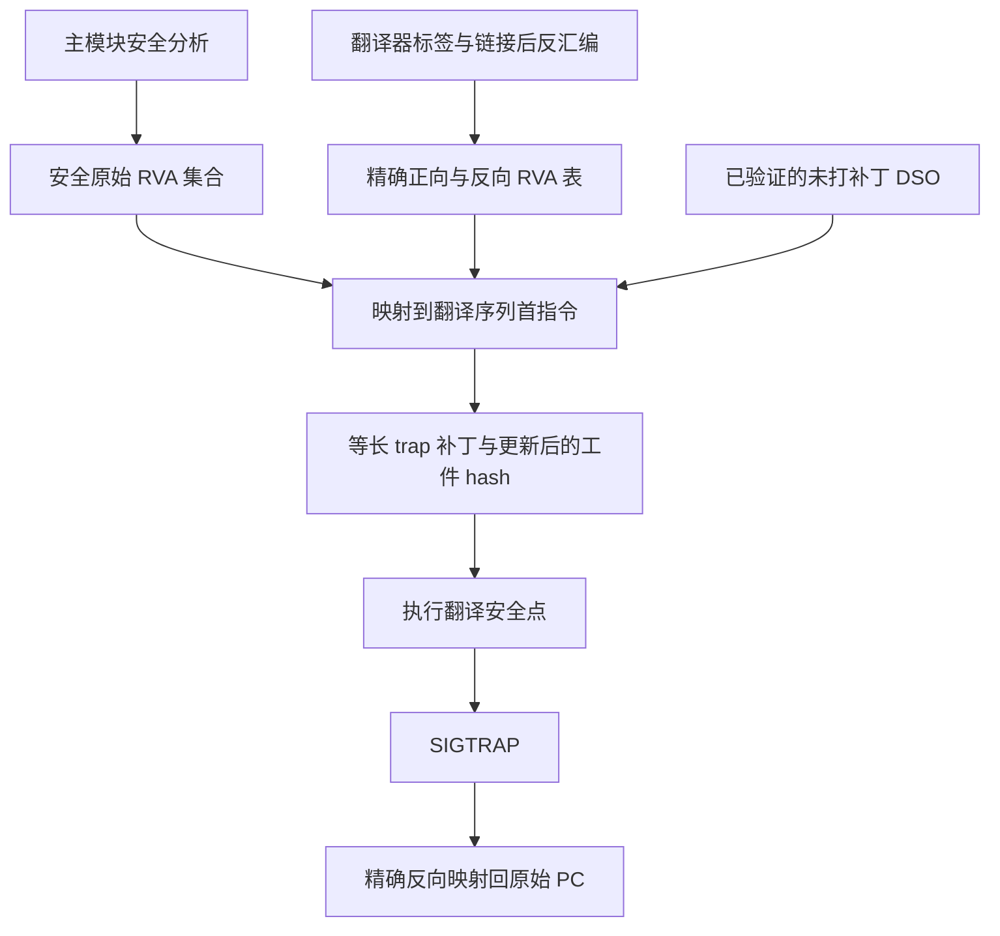

# Linux / RISC-V64 / RVV 场景

当前内置 scene 为 `linux_riscv64_rvv_v1`，Runtime ABI 为 1，ELF machine 为 RISC-V 的 243。它支持两条显式路由，分别让目标硬件执行源 VLEN 的 RVV 语义：

| `source` | `target` | body 标签 | 方向编号 |
| --- | --- | --- | --- |
| `riscv64;rvv;vlen=1024` | `riscv64;rvv;vlen=256` | `CHIMERA_CODE_TRANSLATED_1024_TO_256=1` | `CHIMERA_DIR_1024_TO_256=0` |
| `riscv64;rvv;vlen=256` | `riscv64;rvv;vlen=1024` | `CHIMERA_CODE_TRANSLATED_256_TO_1024=2` | `CHIMERA_DIR_256_TO_1024=1` |

端点解析、合法路由和生产命名由 `analysis_profile/target.py` 的 `RvvTranslationSemantics` 统一定义；同端点或其他 VLEN 对被拒绝。`config.translators` 按 source/target 绑定翻译器路径，workflow 的 `translate` 再声明本次实际生产的路由。通用端点字符串能被解析，不代表该 scene 接受那条路由。

## 属性、变体与路由选择

每个模块的每条路由生成独立 variant。其 `input` 和 `output` 两侧均包含 `architecture:token=riscv64`、`architecture_extension:token=rvv` 和 `vector_vlen_bits:u64`。每个模块最多有一个相同源 VLEN selector；Runtime 从源端点选择目标变体。

`chimera_rvv_route_id(source_vlen_bits, target_vlen_bits)` 统一生成路由 ID，当前派生为 `(source << 32) | target`，在已支持的两条路由上唯一。Manifest 装载和入口迁移决策都调用这一函数；通用 registry 将它作为不透明值比较。

翻译产物包括独立 DSO、反汇编、provenance 汇编和未打补丁副本。typed property 与 variant 记录的指纹成为 DSO 导出符号的一部分；Runtime 必须匹配该符号，防止把字节本身完整但属于另一组端点属性的翻译代码当作当前变体使用。

## Runtime 与翻译器的共享状态

Runtime 导出 `query_original_translated_map()`、scene/ABI marker，以及以下两个 TLS 状态数组和对应取址函数：

```text
simulated_cpu_state_riscv64_rvv_1024_riscv64_rvv_256
simulated_cpu_state_riscv64_rvv_256_riscv64_rvv_1024
get_simulated_cpu_state_addr_riscv64_rvv_1024_riscv64_rvv_256
get_simulated_cpu_state_addr_riscv64_rvv_256_riscv64_rvv_1024
```

两个方向使用独立线程局部状态，每个数组的 Runtime 容纳尺寸为 **4192 字节**。翻译器公共逻辑布局的总大小为 `0x1040`（4160 字节）；容纳尺寸与逻辑布局不应混为一谈。

| 字段 | 偏移或解释 |
| --- | --- |
| 向量 payload | `0x0000` 起；1024→256 为每个逻辑寄存器 128 字节，256→1024 的源物理寄存器按每个 32 字节紧凑解释 |
| `vstart` | `0x1000` |
| `vxsat` / `vxrm` | 公共翻译布局为 `0x1008` / `0x1010` |
| `vcsr` | `0x1018` |
| `vl` | `0x1020` |
| `vtype` | `0x1028` |
| `vlenb` | `0x1030` |

入口保存例程写入 payload、`vstart`、`vcsr`、`vl`、`vtype`、`vlenb`；不能从公共布局中有独立槽位就推断所有路径都会单独保存 `vxsat` 与 `vxrm`。1024→256 后端按 128 字节源槽处理；256→1024 过渡后端的 `state_view` 读取紧凑源布局，不能套用固定 128 字节槽解释。

`StateAccessEmitter` 固定每个输出方向的状态符号和查询 profile。默认 Initial-Exec TLS 序列装载状态基址；helper 兼容路径包含普通调用破坏语义，需要翻译 wrapper 保护相关寄存器。这些导出、偏移和 body 编号属于共享 ABI，修改时应同时核对 Runtime 头文件、状态保存实现、翻译器 contract/layout/state-view 和 [ABI 文档](../../../abi/README.md)。

## 内核通知与信号上下文

当前入口信号号为 **41**，退出使用 **SIGTRAP（Linux 信号 5）**。Linux UAPI 层只负责安装 `SA_SIGINFO` handler 和读取操作系统上下文的基础接口；scene 负责解释通知、向量布局和迁移方向。

入口采用现有的迁移后 packed 通知：`siginfo_t.si_ptr` 的低 32 位携带源 `vlenb` 和 `vl`。`vlenb = packed & 0x3fff`，`vl = (packed >> 14) & 0x1ffff`；`vlenb` 必须在 `1..128`，随后根据 `vlenb * 8` 选择 1024 或 256 的源路由。未支持的源宽度不会形成迁移决策。信号帧中的宽度可能已经描述目的 CPU，因此入口保存使用 packed 源值。

当前向量帧解析检查扩展头 magic `0x53465457`，并按项目所需的内核保存布局解释 `datap`：v0/v8/v16/v24 四组的起点间隔固定为 1024 字节。Runtime 根据源 `vlenb` 把每组的 8 个物理寄存器拷贝进相应方向的紧凑 payload，再保存控制字段。该布局和通知协议需要目标内核配合；不能把普通 Linux/RVV 信号支持视为已满足全部条件。

手动控制适配器将 `1024-to-256` 编码为负 TID，`256-to-1024` 编码为正 TID，写入配置的 `ai_thread_control`。迁移前检查线程的 5/41 信号已捕获、未忽略且未阻塞。当前控制路径没有 proposal/ACK 完成协议；控制写入和 handler 就绪不能替代真实迁移完成证据。

环境验证会检查 pinned BPF map 的 key/value 布局以及控制接口存在且可写。BPF 注册只提交模块 inode 与一个零偏移，队列 key 是不透明请求标识；这不是按安全点地址注册断点。内核消费队列和实际迁移属于目标系统集成，需与用户态 ABI 单独核对。

## 安全点、trap 和 offset-map



offset-map 从翻译器源标签和链接后反汇编恢复映射，以各自 ELF load base 归一化为 RVA；ELF 表交付给 Runtime，JSON 留作离线补丁和 replay 的内部数据。正反表使用精确键查询，不做区间插值。

`patch-safepoints` 当前处理 `safety_analysis` 对应的主模块：将安全原始 RVA 经映射转换为翻译指令 RVA，从已验证未打补丁副本重新生成翻译 DSO，再登记更新后的摘要。安全集合缩小时，旧 trap 会因重新从原副本构造而被恢复。重建预检查发现副本或其 checksum 无效，会要求重跑对应翻译生产者。

RVV trap 服务按原槽位长度生成 `0x9002` 的 16 位 `c.ebreak` 或 `0x00100073` 的 32 位 `ebreak`；截断、48 位及更长指令编码明确失败。补丁不改变代码长度，所以已生成的 RVA 映射仍有效。输入应用 ELF 与 scalar 模块不在补丁范围内。

翻译器也可能为无法直接执行的路径产生 trap。不能假定翻译 DSO 中每个 trap 都是合法安全退出点；只有当前 PC 的反向映射能给出可恢复原始地址。

## 地址查询与失败语义

`query_original_translated_map(target_type, addr_in)` 的 `target_type` 使用 0/1/2 body 标签，而不是方向编号 0/1。

| 情况 | 返回与行为 |
| --- | --- |
| `target_type` 无效 | 返回 0 |
| 无 registry，或地址不属于已知原始/翻译代码体 | 返回输入地址 |
| 地址已经处于请求的目标 body | 返回输入地址 |
| 原始体到指定翻译体，找到精确正向条目 | 返回目标翻译 PC |
| 原始体到指定翻译体，缺变体或精确映射 | 返回输入地址，入口 handler 不切换 |
| 翻译体到原始体，找到精确反向条目 | 返回原始 PC |
| 已识别翻译体缺反向条目 | 返回 0；退出 handler 记录地址并 `_exit(128 + SIGTRAP)`，即 133 |
| 一个翻译 body 直接查询另一个翻译 body | 返回 0；当前机制不做翻译体间直接切换 |

入口还要求原始 PC 属于模块、该地址不是已知安全地址、有与源宽度匹配的 variant，并能成功保存源向量状态。任一条件不满足时保持原 PC；这个行为只描述处理器决策，不能被解释为任意未知内核通知都安全兼容。

通用装载与失败状态见[在线运行时](../../runtime.md)，安全性证明见[安全点分析](../../safepoints/README.md)。关键源码是 `analysis_profile/target.py`、`analysis/{translation,offsetmap,safepoint_patch}/`、`runtime/runtime/migration/linux_riscv64_rvv_v1/`、`runtime/runtime/state/linux_riscv64_rvv_v1/`、`runtime/interfaces/abi/linux_riscv64_rvv_v1/runtime_v1.h` 及翻译器 `src/riscv/extensions/rvv/runtime/`。
