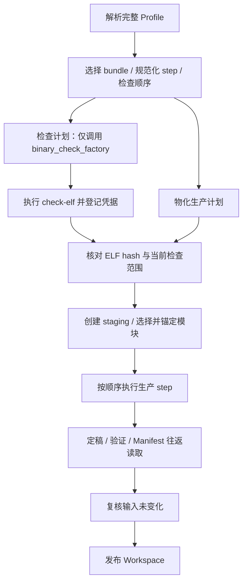
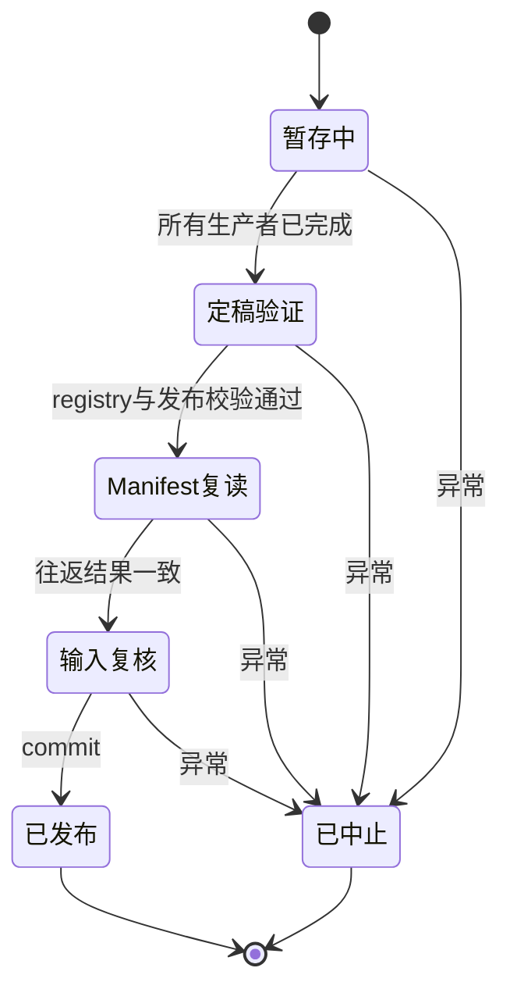

# 离线流水线与发布事务

离线端接受完整 Profile，先解析和验证 workflow，再把它物化为执行计划。`PreparePipeline` 只执行这个计划，不再次读取 TOML，也不在执行过程中猜测 step 或 target。

## 从配置到生产

`config/loader.py` 解析 `[config]` 和 `[profile]`；`analysis_profile/parser.py` 的 `resolve_workflow_steps()` 根据四元 target key 选择 bundle，检查 runtime ABI，查询 step catalog 并规范化参数。声明顺序就是执行顺序，解析器不做拓扑重排。

每个实例获得形如 `001:prepare-workspace` 的标识。不可重复的 step 出现两次、未知参数、缺失参数、路由冲突或缺失生产者都会失败。某个输入的任何生产者仍位于消费者之后时，计划也会被拒绝；这个规则使集合消费者等待所有声明的贡献者。workflow 最终必须提供 `published_workspace`。

`build_execution_plan()` 随后创建 bundle 的 architecture、platform、toolchain 服务、`WorkspaceRepository`，并调用各 step 的 `factory(parameters, configuration, repository)`。工厂负责构造对象，实际生产工作由 `run(context)` 完成。

## 检查与准入

`analysis_profile/checks.py` 从 step 的可选 `binary_check_factory` 生成 `BinaryCheckRequest`。相同的 `check_id`、`version`、规范化参数会合并成一次检查，并保留请求者标识。检查阶段不实例化生产 step、不分配 Workspace；只有运行具体检查时才调用所需工具。

检查范围包括 target 四元组、runtime ABI、检查 ID、版本和参数；再与输入 ELF 的整文件 SHA-256 一起计算凭据指纹。`check_admission()` 要求凭据仍匹配当前内容和范围。已整改但未复查、输入变化、检查升级或参数变化均要求重新执行 `check-elf`。当前 Safety 检查为 `safety.stack-liveness`，版本 **31**；旧版本的成功凭据不满足当前准入。

没有声明二进制检查的 workflow 不要求凭据。`prepare` 的 `--allow-problematic` 是显式接受当前匹配凭据中的问题，不会修复诊断，也不把结论改写为安全。`chimera-dev rebuild` 也执行当前检查准入。具体诊断与处理流程见[诊断指南](../diagnostics.md)。

## step 的数据契约

`StepDefinition` 声明 `requires`、`provides`、参数、重复性和工厂，以及可选的声明校验、执行后条件、发布校验、replay 和重建策略。`AnalysisContext` 是不可变数据类；step 使用 `put_global()`、`with_stage()` 等方法返回新 context，不能用普通字典替代返回值。

流水线在执行前检查 `requires`，执行后检查返回类型、`provides` 和 `postcondition`。缺少结果会形成 `StepContractError`。已声明结果最后一次被消费后，流水线可以从 context 释放它；不能依赖某个未列入 `requires` 的历史结果一直存在。

| step | 主要输入 | 主要输出或效果 |
| --- | --- | --- |
| `prepare-workspace` | 输入 ELF、配置与服务 | `workspace_session`、`modules`；复制随包 scalar，锚定选中输入 |
| `build-runtime` | `workspace_session` | `runtime_artifact`；构建并登记 Runtime |
| `disassemble` | `modules` | `native_dumps` |
| `build-program-model` | `native_dumps` | `programs` |
| `safety` | `modules`、`programs` | `safety_analysis`；登记安全分析工件 |
| `translate` | `modules`、`native_dumps` | 累积 `translations`；每个模块、路由的翻译产物 |
| `offset-map` | `modules`、完整 `translations` | `offset_maps`；登记双向映射 ELF |
| `patch-safepoints` | `modules`、session、安全结果、翻译和映射 | `patched_safepoints`；按安全点重建翻译 DSO 中的 trap |
| `finalize-workspace` | session、全部贡献和 bundle 的完成要求 | `published_workspace` |

表中省略了共同的 `workspace_contributions` 输出。它由流水线为声明该输出的 step 自动追加实例标识；finalizer 对它的依赖构成发布屏障。当前 RVV bundle 的完成要求是 `modules`、`runtime_artifact`、`translations`、`offset_maps`，所以 Safety 是可选 step；需要安全点退出机制的 workflow 应显式包含 `safety` 和 `patch-safepoints`。当前 `SafetyStep` 以主模块为分析入口，不能把该表理解为已对每个依赖执行完整安全分析。

## 集合结果与 registry

`translate` 可以重复，每次为所请求的路由处理模块，并按 `TranslationKey(module_id, source_endpoint, target_endpoint)` 累积结果；后条件要求集合增长。当前 RVV 声明校验禁止为同一个 source endpoint 重复选择输出路由。`offset-map` 必须位于所有 `translate` 之后。

context 保存后续计算需要的内存对象；`WorkspaceRegistry` 保存待发布的 module、variant、typed property 和 artifact 记录。登记 artifact 时必须已有真实文件，路径不能逃出 staging，SHA-256 必须匹配；不同 artifact ID 不能占用同一路径。重建允许同一 artifact ID 更新记录。不能用文件存在代替登记，也不能把 session 记账结果当作数据依赖。

## 增量重建与 replay

`RebuildPipeline` 打开已发布 Workspace 的临时副本，重建选中的 step 及其受影响的后续消费者。`prepare-workspace` 不能重跑；重建从 Manifest 恢复模块集合，并根据本次 `--input` 重新解析目标机文件与 scalar 选择，检查模块仍可解析且选择种类一致。

重建执行集合由以下因素共同决定：

1. 用户指定的 step 名称或精确实例标识。
2. `rebuild_preflight` 追加的精确实例标识，例如缺失未打补丁副本时要求重做相应翻译。
3. `rebuild_inputs` 与已失效输出相交所触发的后续执行。
4. `rebuild_execute=True` 的 step；当前补丁和 finalizer 每次执行。

`rebuild_inputs` 默认从 `requires` 中排除 `workspace_session`、`workspace_contributions`、`capabilities`，避免单纯的调度或发布记账导致整条链失效。

跳过的 step 必须提供 `replay(parameters, context)`，从已有文件恢复内存结果，而非只声称“已有工件”。replay 同样检查输入、返回类型和输出，并重新登记发布校验；缺少必要文件、属性或回调会明确失败。replay 不替代步骤的重新计算，适用前提是其旧结果仍可恢复并满足下游契约。

重建计划是绑定当前 pipeline、workflow、session 和 staging 的一次性 token；执行时检查其来源、快照、请求和执行列表，不能把自行拼接或已消费的执行列表作为授权。随包输入在 staging 中保持硬链接以保留 inode，生成文件和工件复制后再改写；step 不得写入模块输入。交付包通常不含 replay 所需的 `generated/`、`dump/`，因此安装后的精简包不能直接视作完整重建缓存。

## finalizer 与失败恢复

finalizer 将 registry 定稿为 Manifest，运行 target 和 step 注册的发布校验，把它写为 `artifacts/modules.tsv`，按 Workspace 根目录重新读取并比较，再复核输入锚点，最后提交。它不负责推测缺失工件，也不修复生产者输出。

普通 prepare 用同一根目录内的目录替换发布 staging。重建覆盖现有 Workspace 时，先把旧目录移至唯一备份，再安装新目录；安装失败会尝试还原旧目录。如果连还原也失败，异常保留并指出备份位置。发布成功后清理旧备份失败只记录警告。流水线捕获异常时中止未完成 session，删除属于它的 staging；这描述的是代码处理异常的恢复路径，不承诺对进程被强制杀死或系统掉电提供日志式事务恢复。

主要实现位于 `preprocessing/offline/analysis_profile/{parser,pipeline,rebuild,replay,checks,registry}.py`、`analysis/core/{contracts,workspace}/` 和 `analysis/finalize_workspace/`。输入与交付细节见 [Workspace](workspace.md)，安全算法见[安全点分析](safepoints/README.md)。
