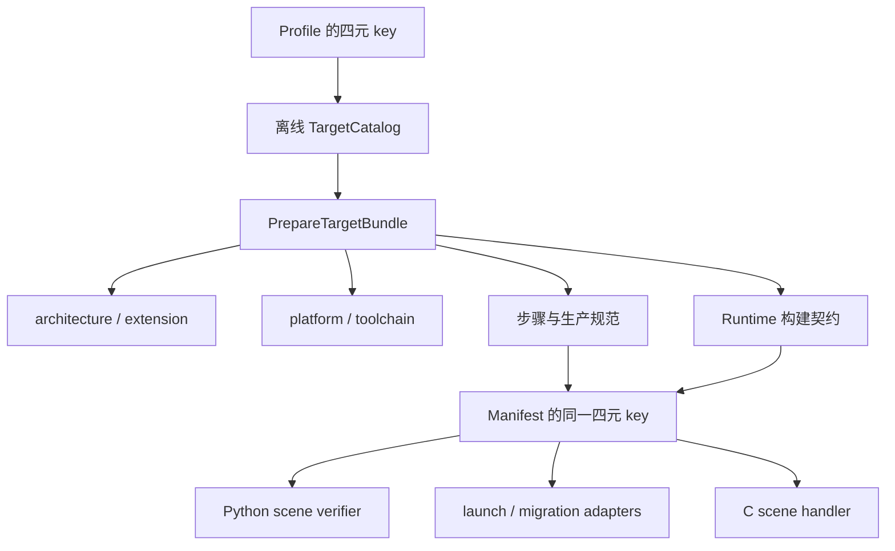

# 目标、场景与通用机制

当前唯一内置组合为 `linux / riscv64 / rvv / linux_riscv64_rvv_v1`，目标细节见 [RVV](rvv/README.md)。这里的接口分层描述扩展方式，不构成其他平台已可运行的支持声明。

## 四元选择键

`TargetKey` 由 `target_os`、`target_arch`、`target_arch_extension`、`runtime_scene` 组成。Profile 解析按它选择离线 bundle，Manifest 保存同样字段；Python 验证器、launch adapter、migration adapter、Runtime 工件契约和 C scene handler 也必须选中同一组合。runtime ABI 另行检查。

端点 `architecture;extension;specification` 只描述翻译源和目标的语义属性；它不代替操作系统和 Runtime 场景选择。当前 RVV 使用 `riscv64;rvv;vlen=1024` 与 `riscv64;rvv;vlen=256`，具体支持路由由 bundle 校验。

## 职责边界

| 层 | 拥有的事实 | 不应承担的工作 |
| --- | --- | --- |
| 通用 workflow | step 顺序、输入输出契约、replay、失效传播和发布事务 | 解释 VLEN、信号号或具体 trap 编码 |
| architecture | 指令、CFG 与栈语义的架构接口 | 决定应用包的路径布局 |
| extension | 向量配置、活跃性、标量宽度事实等扩展能力 | 假设所有平台都有向量状态 |
| platform | 文件依赖解析、ELF 装载布局、工具执行与能力检查 | 决定某条 VLEN 迁移路由 |
| toolchain | 反汇编、编译、翻译调用及工件汇编发射 | 修改输入 ELF 以适配 Workspace |
| target bundle | 组合上述服务、step、端点语义、路径和发布要求 | 证明目标内核已完成真实迁移 |
| runtime scene | body/route 含义、状态符号、信号、上下文、迁移决策 | 重新计算离线安全性证明 |
| 通用模块 registry | 地址范围、精确双向映射、safety 查询与不透明 route/body | 解析 `route_id` 的位编码 |

## 跨层一致性

Manifest 的 variant property 有类型，但通用 codec 不知道 `vector_vlen_bits` 的目标含义。离线 bundle 校验端点与属性，Python scene verifier 校验拓扑和工件，C scene loader 再解释属性并装载变体。翻译 provenance 将 variant 与 typed property 的指纹写入翻译 DSO，在线加载时核对。

同样，通用代码体标签只有 `CHIMERA_CODE_ORIGINAL=0` 与非零翻译体的区分；RVV scene 定义非零标签和查询函数的方向含义。通用 route 只要求模块内唯一，具体派生方式由 scene 保持一致。

新增组合应贯通上述所有消费者，并验证目标文件格式、动态装载、编译工具链、线程状态与内核接口。仅增加配置字段、Python catalog 项或 capability 名称不足以完成支持。真实注册点见[扩展机制](../extensibility.md)，协议字段见 [ABI](../../abi/README.md)。
