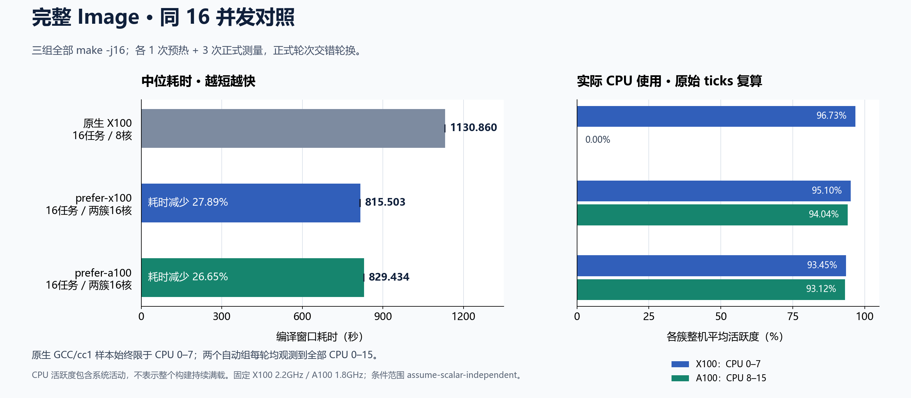

# K3 GCC 同16并发性能对照报告

结论：在本机固定环境与 `assume-scalar-independent` 条件范围内，有效性能套件全部完成并通过独立审计。完整 Image 构建的中位耗时：原生 1130.860 秒，prefer-x100 815.503 秒，prefer-a100 829.434 秒。

相对原生组，prefer-x100 耗时减少 27.89%（吞吐比 1.387×），prefer-a100 耗时减少 26.65%（吞吐比 1.363×）。三组全部为 -j16；原生16个编译任务仅用X100的8核，两个自动组可跨两簇共16核。收益包含核心扩展、放置策略及运行时成本；不能全部归因于一次迁移操作。

prefer-x100 的 Image 中位耗时比 prefer-a100 低 1.68%。以下同并发与静态分簇对照用于进一步观察策略成本。

## 完整 Image：3 次正式测量/组

| 组别 | 并发 | 三次原始耗时（秒） | 中位数（秒） | 最小–最大（秒） | 相对原生吞吐比 | 耗时减少 |
|---|---:|---|---:|---|---:|---:|
| 原生 X100（不迁移） | 16 | 1130.860216, 1131.021261, 1130.656532 | 1130.860 | 1130.657–1131.021 | 1.000× | 0.00% |
| 自动 prefer-x100 | 16 | 815.503384, 813.115462, 815.513563 | 815.503 | 813.115–815.514 | 1.387× | 27.89% |
| 自动 prefer-a100 | 16 | 829.991899, 828.747735, 829.433934 | 829.434 | 828.748–829.992 | 1.363× | 26.65% |

吞吐比 = 原生组中位耗时 ÷ 本组中位耗时；耗时减少 = 1 − 本组中位耗时 ÷ 原生组中位耗时。Image 吞吐单位为完整构建/秒。

## 相同并发：每轮相同的 64 个真实 Kbuild C 编译任务

每个并发点与组别分别有 1 次预热、5 次正式测量。静态分簇按固定 worker 槽位交替放到 X100/A100，共享任务队列；并发 1 时只有一个 X100 worker，并发 8 时为 4+4，并发 16 时为 8+8，并发 24 时为 12+12。原生组始终使用 X100 的 8 个 CPU。

| 并发 | 组别 | 五次原始耗时（秒） | 中位数（秒） | 最小–最大（秒） | 任务/秒 | 同并发原生吞吐比 |
|---:|---|---|---:|---|---:|---:|
| 1 | 原生 X100（不迁移） | 223.269479, 223.119353, 223.215473, 223.113239, 223.389529 | 223.215 | 223.113–223.390 | 0.287 | 1.000× |
| 1 | 自动 prefer-x100 | 225.637068, 225.792440, 225.746089, 225.907922, 225.661146 | 225.746 | 225.637–225.908 | 0.284 | 0.989× |
| 1 | 自动 prefer-a100 | 476.433984, 473.375273, 477.111558, 474.114229, 478.003363 | 476.434 | 473.375–478.003 | 0.134 | 0.469× |
| 1 | 静态分簇（不迁移） | 223.208819, 223.317863, 223.273431, 223.288605, 223.338292 | 223.289 | 223.209–223.338 | 0.287 | 1.000× |
| 8 | 原生 X100（不迁移） | 36.543828, 36.470919, 36.564745, 36.578590, 36.660620 | 36.565 | 36.471–36.661 | 1.750 | 1.000× |
| 8 | 自动 prefer-x100 | 44.308402, 45.660142, 44.119548, 42.696193, 45.519498 | 44.308 | 42.696–45.660 | 1.444 | 0.825× |
| 8 | 自动 prefer-a100 | 55.998691, 49.854891, 52.754285, 54.024632, 53.171894 | 53.172 | 49.855–55.999 | 1.204 | 0.688× |
| 8 | 静态分簇（不迁移） | 52.052467, 52.631685, 52.236496, 52.111549, 52.058605 | 52.112 | 52.052–52.632 | 1.228 | 0.702× |
| 16 | 原生 X100（不迁移） | 36.866299, 37.000638, 36.959169, 37.682867, 37.689759 | 37.001 | 36.866–37.690 | 1.730 | 1.000× |
| 16 | 自动 prefer-x100 | 28.167901, 30.292818, 29.610673, 29.547641, 27.811197 | 29.548 | 27.811–30.293 | 2.166 | 1.252× |
| 16 | 自动 prefer-a100 | 37.745455, 37.043242, 37.186198, 35.795867, 33.186338 | 37.043 | 33.186–37.745 | 1.728 | 0.999× |
| 16 | 静态分簇（不迁移） | 30.443013, 38.805059, 35.117813, 35.222474, 30.364963 | 35.118 | 30.365–38.805 | 1.822 | 1.054× |
| 24 | 原生 X100（不迁移） | 37.002672, 36.396294, 36.126684, 37.081367, 36.673799 | 36.674 | 36.127–37.081 | 1.745 | 1.000× |
| 24 | 自动 prefer-x100 | 27.416228, 29.668947, 28.623864, 28.577292, 28.660501 | 28.624 | 27.416–29.669 | 2.236 | 1.281× |
| 24 | 自动 prefer-a100 | 30.893143, 31.817227, 30.793977, 34.070091, 36.111684 | 31.817 | 30.794–36.112 | 2.011 | 1.153× |
| 24 | 静态分簇（不迁移） | 39.793707, 39.571979, 34.668283, 42.356497, 37.008912 | 39.572 | 34.668–42.356 | 1.617 | 0.927× |

### 自动组相对静态分簇

| 并发 | prefer-x100 / 静态吞吐比 | prefer-a100 / 静态吞吐比 | prefer-x100 / prefer-a100 吞吐比 |
|---:|---:|---:|---:|
| 1 | 0.989× | 0.469× | 2.110× |
| 8 | 1.176× | 0.980× | 1.200× |
| 16 | 1.189× | 0.948× | 1.254× |
| 24 | 1.382× | 1.244× | 1.112× |

这些是同一任务集合的整批吞吐对照。静态组与自动组的放置方式、运行时开销、任务分配和迁移共同影响结果；该对照不能单独测出一次迁移的延迟。

## 实际执行与迁移旁证

正式计时关闭详细 debug/kprobe，所有组统一进行约 0.5 秒周期的 CPU、温度、频率与内存采样。原始指标字节 SHA、样本数与摘要已重新核对。下面 CPU 分簇数是 cc1 的离散观测点数量，不是 CPU 时间占比。迁移数是计时窗口前后的内核已提交计数增量；逐 TID 的 ACK/CPU 证明来自独立预检。

| 工作负载 | 组别 | cc1 在 X100/A100 的观测点 | 256→1024 提交增量 | 1024→256 提交增量 |
|---|---|---|---:|---:|
| units | 原生 X100（不迁移） | 13220 / 0 | 0 | 0 |
| units | 自动 prefer-x100 | 7544 / 3992 | 628 | 362 |
| units | 自动 prefer-a100 | 5208 / 9166 | 848 | 108 |
| units | 静态分簇（不迁移） | 6461 / 5523 | 0 | 0 |
| image | 原生 X100（不迁移） | 80050 / 0 | 0 | 0 |
| image | 自动 prefer-x100 | 28225 / 29715 | 4033 | 175 |
| image | 自动 prefer-a100 | 28278 / 29905 | 4436 | 17 |

预检 1：8 组、128 条真实 xgcc→exec cc1 编译链，实际初始化与每 exec 就绪、原始 action=1/return=8 ACK 和实际 CPU 提交已重放，数值参考与所有对象 SHA 一致；未注册 as 保持严格 unready 且无跨 VLEN 提交。双向 cc1 提交为：prefer-x100 {'256-to-1024': 22, '1024-to-256': 24}，prefer-a100 {'256-to-1024': 35, '1024-to-256': 21}。

预检 3：8 组、128 条真实 xgcc→exec cc1 编译链，实际初始化与每 exec 就绪、原始 action=1/return=8 ACK 和实际 CPU 提交已重放，数值参考与所有对象 SHA 一致；未注册 as 保持严格 unready 且无跨 VLEN 提交。双向 cc1 提交为：prefer-x100 {'256-to-1024': 15, '1024-to-256': 23}，prefer-a100 {'256-to-1024': 35, '1024-to-256': 21}。

## 存储维护与环境限制

用户授权将实际 BKOPS 0/1/2，以及精确 priority=3、控制器 c0e00000.ufshc、ufshcd_bkops_exception_event_handler 的 status 1/2 维护消息单列保留。全部原始字节、时间、序号、等级、SHA 与次数均保留；状态 3、未知状态、critical health 非零、I/O 错误、其他未知内核告警仍失败。未修改驱动、设备、电源或日志级别。

| 正式测量集合 | 组别 | BKOPS 0/1/2 健康采样数 | 精确 status 1/2 内核消息数 |
|---|---|---|---|
| units | 原生 X100（不迁移） | 89 / 1 / 0 | 0 / 0 |
| units | 自动 prefer-x100 | 80 / 1 / 0 | 0 / 0 |
| units | 自动 prefer-a100 | 127 / 3 / 0 | 2 / 0 |
| units | 静态分簇（不迁移） | 89 / 0 / 1 | 1 / 0 |
| image | 原生 X100（不迁移） | 114 / 3 / 0 | 1 / 0 |
| image | 自动 prefer-x100 | 82 / 3 / 0 | 0 / 0 |
| image | 自动 prefer-a100 | 84 / 3 / 0 | 0 / 0 |

包含预热的完整 108 轮共保留健康采样 855 条（BKOPS 0/1/2 = 835/18/2），精确维护日志 status 1/2 = 5/0。critical health 全部为 0，未知内核告警与日志序号缺失为 0。健康状态约每 30 秒只读采样，并在边界额外采样；不能从离散观测推断状态 2 的持续时长或具体性能损失，所报成绩包含本机当时的存储环境影响。

CPU 频率维持 userspace 配置：X100 2.2GHz、A100 1.8GHz，未作调频或电源更改。两套工作负载各在 130 秒空闲后冻结 7 个温度传感器基线，每轮起始温度均在相应基线 +3°C 上限内；正式采样频率记录及当前 governor/min/max/setspeed 均已核对。

## 计时、资源和正确性

- 全部 108 轮均有真实 systemd success/exited/0、资源与 time 记录。各轮 OOM/oom_kill=0、swap 峰值=0，九项迁移账本均在边界归零，无新增迁移超时。
- 成绩取内部 CLOCK_MONOTONIC 的编译窗口，包含编译器启动、bootstrap 和迁移；准备、SHA 校验、冷却在窗口外。外层 time -v 含这些额外阶段，其墙钟不作为成绩。
- 每轮 Image 实际分配至少 12GiB 工作容量探针后，仍有至少 6GiB 空闲；12GiB cgroup 上限、10GiB MemoryHigh、0 swap、有限 4 小时单轮时限。
- 各轮都使用固定源码、公共 config 与确定的构建元数据；64 个任务、当前 seed 对象及全部 Image 记录均与原生 SHA 一致。保留的 canonical Image/vmlinux/System.map/config 已独立重算 SHA。成功轮的自有中间文件已在当时逐项比对后删除；本次复核其原始记录与保留 canonical，不声称重新读取已经删除的中间文件。

| Canonical 工件 | SHA256 |
|---|---|
| Image | `20dfa1adb1a77e2690794b70c9efb980e8eb2f6de08e922f3550ce8ec424d684` |
| vmlinux | `c436edb1f58c684142b03678332c61551b77e1c968f21a546718da55a6dc73aa` |
| System.map | `6046d5751ff458feaa2de6fab54068a02b4cf3f71db3aadee13a608a0a8e1f9b` |
| config | `0ecfe62d06dbe0bca2dd1dc1ba61e9cbec26071c9ef3200c782c89459b8e1cf4` |

## 固定身份与条件范围

- Chimera：dev/automigration-subprocess，提交 `578ab8321c0788ab8cba1ad24324f220e1e4a149`。
- 运行内核：`6.18.3-chimera-d02cd7352`；隔离内核源码 HEAD `d02cd73523ab4c7e7e952969b8d2a95925ae64d9` 加原始 730 字节 BSP 补丁。当前整棵源码逐文件与原 git archive 加补丁对比通过。
- xgcc/cc1、bootstrap、Profile、registry、两个 Workspace 的所有工件、78 行当前 receipt 内容与文件身份、variant/table 语义及原生完整表校验通过；没有重发凭据，也没有使用旧 gate 名单替代本轮证据。
- 结论受 `assume-scalar-independent` 与已授权存储维护范围约束；不扩大原静态检查条件，不等同于无条件生产安全或所有程序的性能结论。

## 协议修正与原失败保留

有效套件由保留的单元v2的96轮和全新同16并发i5 Image的12轮组成，分别统计。旧 Image 自动组在 Kbuild 编译器识别时，被 Runtime 可选 parent_thread_id stdout 通知污染，真实 exit=1 的旧 controller2、失败树和日志保留。Image v3 仅省略 CHIMERA_LAUNCH_PID 通知变量，不过滤编译器输出；生产 Runtime/GCC/内核/Profile/registry/初始化/继承/每 exec ready 与迁移处理器不变。12 个 Kbuild 输出探针、14 项边界回归和身份一致的原PF1/PF3真实128链ready/双向ACK+CPU证据再次重放通过。单元 v2 直接执行保存的 -c 命令，未受 Kbuild 版本解析问题影响；旧 Image 预热 1064.498 秒与失败组时长均未并入本报告。

旧 attempt1 因当时未获授权的实际 BKOPS=2 停止，原失败与全部证据保留；没有与本套件池化。第一次最终审计因直接比较原始符号链接文本而失败；已定位 Python 原 data 解包过滤器移除一处 ./，第二次审计严格使用相同过滤结果比较并通过，原审计 exit=1、峰值和索引保留。此修正没有改动测量数据或源码。

## 审计与可追溯文件

独立最终审计 `final-audit-1` 实际 success/exited/0，峰值 372740096 字节，swap/OOM=0；核对证据文件 101829 个。

- 结构化统计：`performance-summary-j16.json`；每轮详情：`audits/final-1/rounds.json`。
- 逐点原始值与复算：`audits/final-1/statistics.json`。
- 当前完整源码、Workspace 与预检重放报告：`audits/final-1/source.json`、`workspaces.json`、`preflight-replay.json`。
- 证据索引：`audits/final-1/evidence-sha256.json`，SHA256 `37c90eed401315c47e8c95abef3c2fbd097274e596f7f1cc3e99f9ab32a11b03`。
- 结果、资源、原始时钟：`results/final-audit-1.json`、`.resources.json`、`.time.txt`。
- 所有数据位于 K3 的 `/root/chimera-gcc-performance-j16-578ab8321-20261030`；旧功能验收目录保持原样。未下载服务器大归档。

报告生成时间：2026-10-30T10:05:43.504473+00:00。

## 同16并发修正与原始CPU ticks复核

本报告全部Image为新的i5-*同16并发数据；旧-j8原生/-j16自动Image时长完全不混池，旧报告与全部证据原样保留。每组1次预热3次正式，正式组序轮换平衡。-j16是并行任务上限，不表示整个构建持续16核满载。make各组均原生运行，仅GCC树施加相应策略。

原生每个GCC/cc1样本均为CPU0-7、Cpus_allowed_list=0-7、preference=none，实际迁移0；自动组每个新Image均观测到全部CPU0-15。保存的每进程PID/starttime/executable/CPU/ready摘要及CPU ticks前后值全部独立重算。

| 正式Image组 | X100/A100整机平均活跃度 | 子进程CPU时间/墙时 |
|---|---|---:|
| 原生 X100（不迁移） | 96.73% / 0.00% | 7.506 |
| 自动 prefer-x100 | 95.10% / 94.04% | 14.880 |
| 自动 prefer-a100 | 93.45% / 93.12% | 14.675 |

整机CPU活跃度包括操作系统等其他活动；子进程CPU时间包含make/编译/汇编/链接，除以编译窗口墙时表示平均消耗的CPU数量。离散CPU观测数不是CPU时间占比，不能据此宣称持续16核满载。

首次同16并发补测prelaunch1因旧计划测试import旧controller而真实exit1，0 Image启动，原代码/日志/资源/索引全部保留；新attempt2明确版本只修复当前计划检查，其余13维护边界不变，共14项0跳过。

图表：
